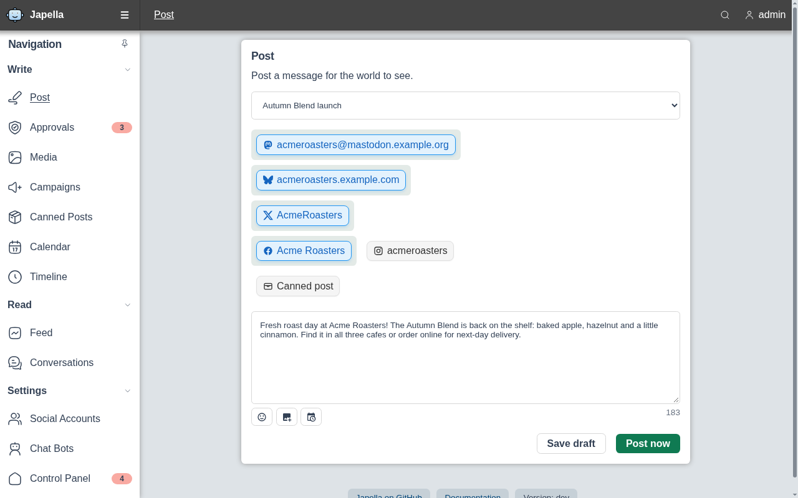
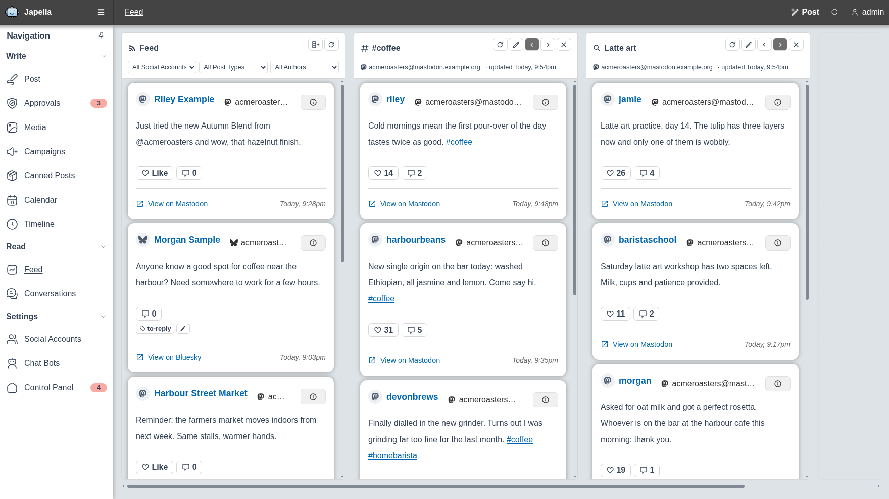
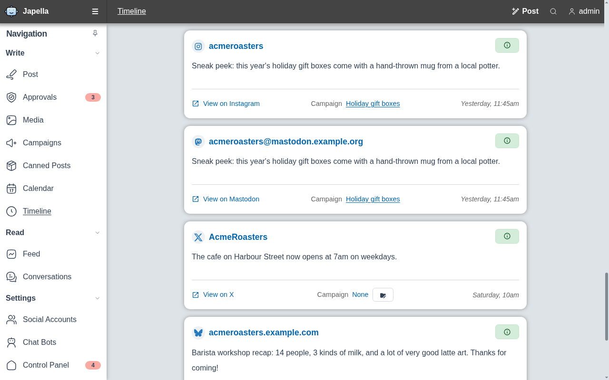
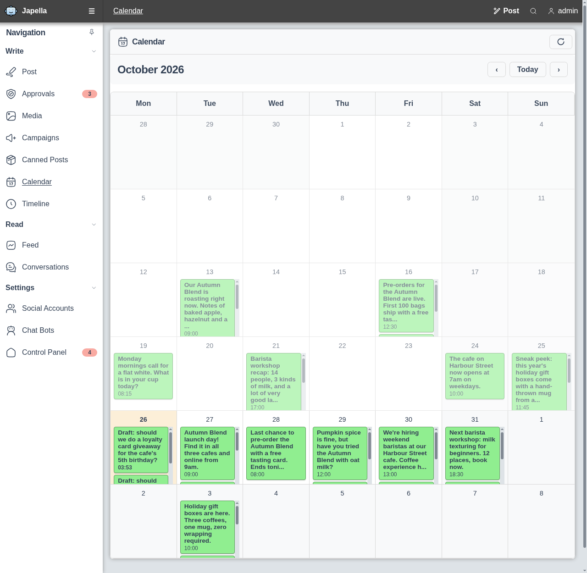
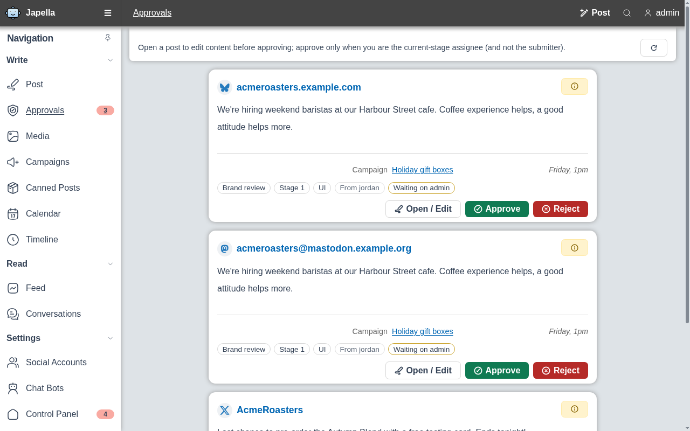
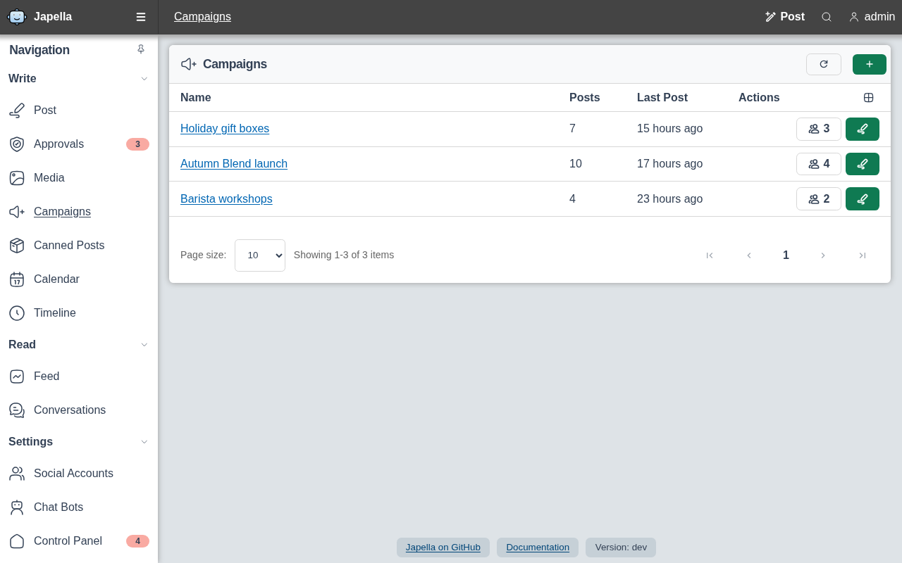
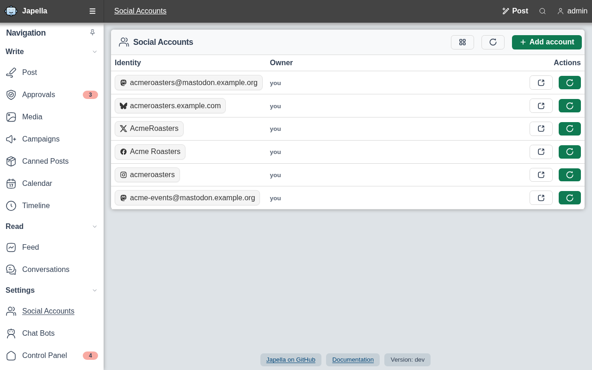
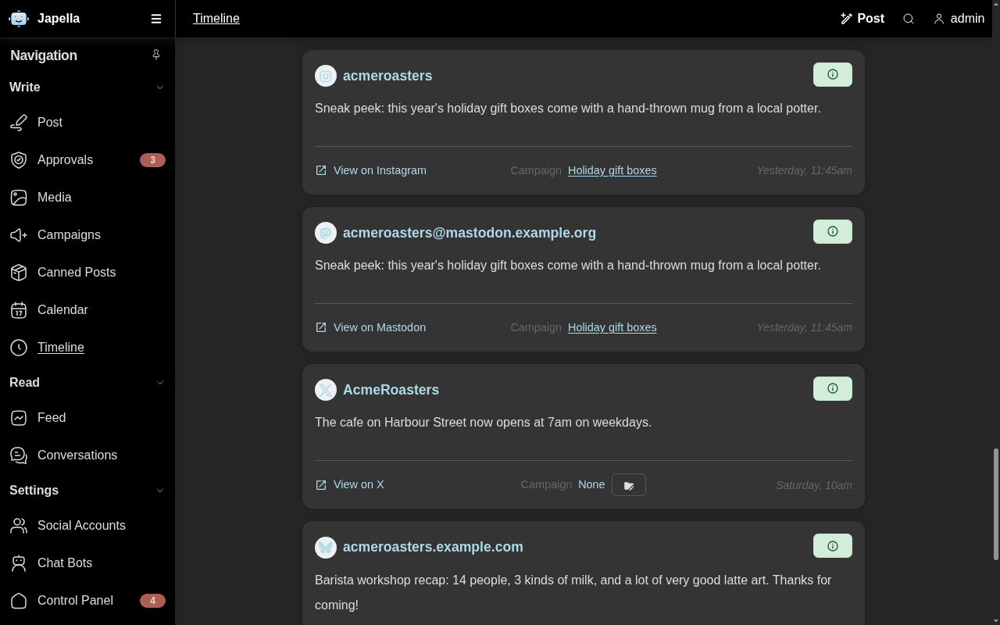

 
 <h1 id="japella">Japella</h1>
 
A social media & chat powertool.

Japella's architecture splits out the connections to different protocols (eg Telegram, Discord) into "adaptor" services, and all bot functionality is implemented in a separate service, meaning that the chatbot functionality can easily work with new protocols, by just creating a new adaptor, or, can relay chat messages across protocols, for example.

## Screenshots

### Compose once, post everywhere

Write a post, pick the Mastodon, Bluesky, X, Facebook and Instagram accounts it should go to, and publish now, schedule it or save a draft.

### Monitor multiple social feeds

Read your feed side by side with columns that follow a hashtag or a search, and keep track of posts with private tags such as to-reply.

### Timeline

Every post you have published, scheduled or drafted, across all of your accounts, with its campaign and a link to the live post.

### Content calendar

See what went out and what is coming up at a glance, so gaps and clashes in your posting schedule are easy to spot.

### Approvals

Account policies can hold posts for review. Approvers see what is waiting for them and approve or reject it before anything is published.

### Campaigns

Group related posts and accounts into campaigns, such as a product launch, and track how much has gone out for each one.

### Social accounts

All of the accounts Japella can post to in one list, including who owns them, so teams can share accounts without sharing passwords.

### Dark mode

Japella follows your light or dark preference, shown here on the timeline.

Screenshots use fictional test data and are regenerated with `make screenshots`
(see [`var/marketing/screenshots`](var/marketing/screenshots/README.md)).

## Quickstart

Japella is only distributed as a x86_64 Linux container, and requires a RabbitMQ server as the message queue.

There is ready-to-go docker-compose.yml file here: <https://jamesread.github.io/Japella/installation/docker-compose/>

## Helpful links

* [Japella Documentation](https://jamesread.github.io/Japella/)

## **Japella is a No-Nonsense Open Source project;**

* All code and assets are Open Source (AGPL).
* No company is paying for development, there is no paid-for support from the developers.
* No separate core and premium version, no plus/pro version or paid-for extra features.
* No SaaS service or "special cloud version".
* No "anonymous data collection", usage tracking, user tracking, telemetry or email address collection.
* No requests for reviews in any "app store" or feedback surveys.
* No prompts to "upgrade to the latest version".
* No internet-connection required for any functionality.

## Docs

Documentation for how to install and use Japella is available at <https://jamesread.github.io/Japella/>
